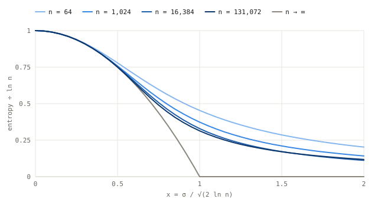
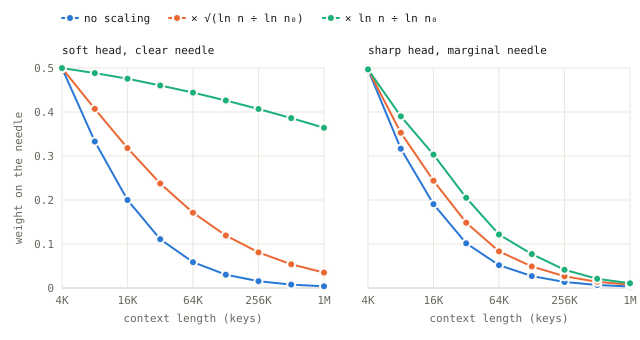

## 1. 问题

[《注意力：一次可微分的查找》](/zh/writing/attention-as-a-differentiable-lookup/)给出了把注意力分数除以 $\sqrt{d_k}$ 的标准理由：随机的 $d_k$ 维向量做点积，标准差为 $\sqrt{d_k}$，而分数一大，softmax 就会饱和。这没有错，但它每次只描述一个键。一个查询是同时关注 $n$ 个键的，真正要紧的，是权重在所有键上怎样分布：有多少个键分享这些权重，以及当 $n$ 从一千个 token 增长到一百万个时，这种分布又会如何变化。

这种分布在统计物理中有一个精确的对应物。在相互独立的高斯分数上做 softmax，就是**随机能量模型**（random energy model，REM）。它由 Derrida 于 1980 年提出，作为无序系统的一个最简模型。REM 有两个相，一个分散相，一个冻结相，两者之间隔着一个陡峭的相变。Lucibello 和 Mézard（2023）把这一对应关系用在了稠密联想记忆上；Giorlandino 和 Goldt（2025）则以它为基础，为初始化时 Transformer 中的信号传播建立了一套完整的理论，其中包括“熵崩溃”（entropy collapse）这种失效模式，以及如何通过初始化来避开它。

本文是对这幅图景的一次逐步推演，写给[《从第一性原理理解 Transformer》系列](/zh/series/transformers/)的读者。它补充了三点：

1. 对两个区的推导，只用到大数定律和一个高斯恒等式，其中包括用一句话说明相变为什么恰好出现在那个位置。
2. 测量实际的序列长度离无限长极限有多远。答案是很远：在模型实际会遇到的每一个长度上，这个相变都是一个缓慢的渐变（crossover）。
3. 把实践中使用的两类随长度变化的 logit 缩放放在一起对照解读。REM 图景能把它们干净利落地区分开：一类让所处的区保持不变，另一类让被检索的键的权重保持不变，而后者会把噪声大的头推向冻结。

文中的每一个数字都来自文中的代码，用 NumPy 跑完大约需要十秒。

> [!NOTE] 并非新的物理
> 这一对应、这些相以及冻结相的结果都是已知的，第 3 节和第 4 节注明了它们的出处。本文提供的是用浅白语言写出的推导、有限尺寸下的测量，以及对几种缩放规则的比较。

## 2. 设定

一个查询给 $n$ 个键打分，$s_j = q \cdot k_j / \tau$，注意力给键 $j$ 的权重是

$$
w_j = \frac{e^{s_j}}{Z}, \qquad Z = \sum_{j=1}^{n} e^{s_j}.
$$

标准注意力取 $\tau = \sqrt{d_k}$。初始化时，投影权重是随机的，各个 token 的表示之间也没有很强的相关性，于是同一个查询的各个分数接近于从 $\mathcal{N}(0, \sigma^2)$ 中独立抽取的样本。如果 $q$ 和 $k$ 的各个分量方差为一，那么 $\sigma^2 = d_k / \tau^2$：缩放后的注意力恰好为 1，不做缩放则为 $d_k$。初始权重越小，$\sigma$ 也越小；token 之间存在相关性时，图景会发生变化，Giorlandino 和 Goldt 对此有完整的处理。下文一律把独立高斯的情形照单全收。

有两个量可以概括权重是怎样分布的：

- **熵** $H = -\sum_j w_j \ln w_j$，介于 0（全部权重落在一个键上）和 $\ln n$（均匀分布）之间。下文报告的是它的占比 $H / \ln n$。
- **逆参与比**（inverse participation ratio）$Y = \sum_j w_j^2$，大致等于真正起作用的键的个数的倒数。

```python
import numpy as np
from statistics import NormalDist

def softmax_stats(scores):
    """Entropy, inverse participation ratio and largest weight of softmax(scores), row by row."""
    top = scores.max(axis=1, keepdims=True)
    e = np.exp(scores - top)                       # shift by the max so exp never overflows
    z = e.sum(axis=1, keepdims=True)
    w = e / z
    log_z = np.log(z[:, 0]) + top[:, 0]
    entropy = log_z - (w * scores).sum(axis=1)     # H = log Z - sum_j w_j s_j
    return entropy, (w ** 2).sum(axis=1), w.max(axis=1)

def gaussian_rows(n, rows, rng, batch=2**22):
    """Standard normal rows of length n, about `batch` numbers at a time."""
    per = max(1, batch // n)
    for start in range(0, rows, per):
        yield rng.standard_normal((min(per, rows - start), n))
```

## 3. 两个区

### 分散区

如果 $Z$ 是许多大小相当的项之和，大数定律就可以把它换成 $n$ 乘以单项的均值。对高斯分数，$\mathbb{E}[e^{s}] = e^{\sigma^2/2}$，所以

$$
\ln Z \approx \ln n + \frac{\sigma^2}{2}.
$$

熵是 $H = \ln Z - \sum_j w_j s_j$，其中第二项是分数的加权平均。同样借助大数定律，它变成 $\mathbb{E}[s\,e^{s}] / \mathbb{E}[e^{s}]$；而高斯变量的 Stein 恒等式 $\mathbb{E}[s\,f(s)] = \sigma^2\,\mathbb{E}[f'(s)]$ 说明它恰好等于 $\sigma^2$。于是

$$
H \approx \ln n + \frac{\sigma^2}{2} - \sigma^2 = \ln n - \frac{\sigma^2}{2}.
$$

把分数离散度放到长度的尺度上来衡量会更方便，令

$$
x = \frac{\sigma}{\sqrt{2 \ln n}}, \qquad \frac{H}{\ln n} \approx 1 - x^2 .
$$

Jin 等人（2023）在让图像模型适应新分辨率时，推导出了同一个熵公式。

### 公式在哪里失效：冻结点

这个公式在 $x = 1$ 处给出零熵，原因就藏在 $\mathbb{E}[e^{s}]$ 背后的那个积分里。被积函数 $e^{s}\,e^{-s^2/2\sigma^2}$ 在 $s = \sigma^2$ 处取得峰值：撑起这个平均值的，是 $\sigma^2$ 附近的分数。可是 $n$ 个高斯样本里，几乎从不会出现高于大约 $\sigma\sqrt{2 \ln n}$ 的分数。只要 $\sigma^2 < \sigma\sqrt{2\ln n}$，也就是 $x < 1$，撑起平均值的那些分数就在样本里，大数定律也就成立。越过这一点，撑起平均值的就是那些并不存在的键，而 $Z$ 由样本中确实存在的少数几个最大分数主导。softmax 于是**冻结**在它们身上。

在 $n \to \infty$ 的极限下，这是一个陡峭的相变，也就是 Derrida 的冻结相变。在它之下，$H / \ln n \to 1 - x^2$。在它之上，$H / \ln n \to 0$，权重集中在少数几个键上，逆参与比趋于 $1 - 1/x$（这是 REM 的结果，Giorlandino 和 Goldt 针对注意力给出了这一表述）。

把同样的论证用在 $\mathbb{E}[e^{2s}]$ 上（它的被积函数在 $2\sigma^2$ 处取得峰值），会在 $x = 1/2$ 处得到第二个阈值。在它之下，$Z$ 围绕均值的涨落也是高斯型的；在它之上则不是（Ben Arous、Bogachev 和 Molchanov，2005；Giorlandino 和 Goldt 指出了它对有限长度的作用）。后面会看到，实际长度正是从这里开始与极限分道扬镳的。

### 有限长度下实际会怎样

下面是四种长度下的熵占比，与极限值对照：

```python
xs = [0.25, 0.5, 0.75, 1.0, 1.25, 1.5]
sizes = [2**6, 2**10, 2**14, 2**17]
rng = np.random.default_rng(0)
curves = {}
for n in sizes:
    g = rng.standard_normal((max(16, 2**22 // n), n))   # one set of draws, reused for every x
    sigma_c = np.sqrt(2 * np.log(n))
    curves[n] = [softmax_stats(x * sigma_c * g)[0].mean() / np.log(n) for x in xs]

print("x     " + "".join(f"n = 2^{int(np.log2(n)):<4}" for n in sizes) + "limit")
for i, x in enumerate(xs):
    print(f"{x:<5} " + "".join(f"{curves[n][i]:<10.3f}" for n in sizes) + f"{max(0.0, 1 - x * x):.3f}")
```

```text
x     n = 2^6   n = 2^10  n = 2^14  n = 2^17  limit
0.25  0.939     0.938     0.938     0.938     0.938
0.5   0.779     0.758     0.753     0.750     0.750
0.75  0.597     0.537     0.507     0.490     0.438
1.0   0.454     0.373     0.329     0.314     0.000
1.25  0.354     0.273     0.229     0.222     0.000
1.5   0.286     0.210     0.172     0.171     0.000
```



在 $x = 0.5$ 之前，四种长度与公式的差距都在 0.03 以内，$n = 2^{17}$ 更是与它精确到小数点后三位。过了这一点，有限长度比极限分散得多。在 $x = 1$ 处，极限已经完全冻结，而一个含 131,072 个键的序列仍保留着最大熵的 31%。

冻结的一侧趋近极限也同样缓慢：

```python
xs = [1.0, 1.5, 2.0, 3.0]
rng = np.random.default_rng(1)
print("n       H / ln n at x = 1, 1.5, 2, 3    Y at x = 1, 1.5, 2, 3")
for n, rows in [(2**10, 4000), (2**13, 2000), (2**16, 600), (2**19, 150)]:
    h = {x: [] for x in xs}
    y = {x: [] for x in xs}
    for g in gaussian_rows(n, rows, rng):
        for x in xs:
            hx, yx, _ = softmax_stats(x * np.sqrt(2 * np.log(n)) * g)
            h[x].append(hx / np.log(n))
            y[x].append(yx)
    mean = lambda v: np.concatenate(v).mean()
    print(f"2^{int(np.log2(n)):<5} " + " ".join(f"{mean(h[x]):.3f}" for x in xs)
          + "     " + " ".join(f"{mean(y[x]):.3f}" for x in xs))
print("limit   " + " ".join(f"{0:.3f}" for x in xs) + "     " + " ".join(f"{1 - 1 / x:.3f}" for x in xs))
```

```text
n       H / ln n at x = 1, 1.5, 2, 3    Y at x = 1, 1.5, 2, 3
2^10    0.373 0.210 0.142 0.085     0.238 0.448 0.576 0.713
2^13    0.333 0.176 0.115 0.068     0.211 0.433 0.567 0.708
2^16    0.302 0.149 0.096 0.057     0.196 0.427 0.564 0.705
2^19    0.287 0.133 0.084 0.049     0.159 0.404 0.546 0.690
limit   0.000 0.000 0.000 0.000     0.000 0.333 0.500 0.667
```

逆参与比从上方趋近 $1 - 1/x$，熵占比向零下降，但长度增加了 512 倍，它们却只移动了 0.02 到 0.09。与极限的距离主要通过 $\ln n$ 依赖于 $n$，而这个对数在这张表里只从 6.9 增长到 13.2。（标准误由各行之间的离散估计，介于 0.001 和 0.02 之间，$2^{19}$ 处的 $Y$ 最大。）

落到实际中，结论是：**相图这张地图没有画错，但在模型实际使用的长度上，边界是一条宽带，而不是一条线**。从 $x \approx 0.5$ 一直到远远越过 $x = 1$，注意力既不分散，也不冻结。

## 4. 为什么 $d_k$ 的平方根是在选择相

不做缩放时，方差为一的查询和键给出 $\sigma^2 = d_k$，因此

$$
x_{\text{unscaled}} = \sqrt{\frac{d_k}{2 \ln n}}, \qquad x_{\text{scaled}} = \frac{1}{\sqrt{2\ln n}}.
$$

当 $d_k = 64$ 时，除非 $2 \ln n > 64$，也就是序列包含超过 $e^{32} \approx 8 \times 10^{13}$ 个 token，否则未缩放的注意力都已越过冻结点。而在任何现实的长度上，缩放后的注意力都处在 $x \approx 0.2$–$0.3$，深深位于分散区之内。用随机的查询和键实测如下：

```python
rng = np.random.default_rng(2)
print("d_k  n      unscaled: x     H/ln n  top weight   scaled: x     H/ln n  top weight")
for d_k in [64, 128]:
    for k in [10, 17]:
        n = 2**k
        rows = max(8, 2**21 // n)
        # For random keys K and a query q, the scores K q are exactly Gaussian with variance |q|^2.
        q_norm = np.sqrt(rng.chisquare(d_k, size=(rows, 1)))
        scores = q_norm * rng.standard_normal((rows, n))
        line = f"{d_k:<4} 2^{k:<4}"
        for scale in [1.0, 1 / np.sqrt(d_k)]:
            h, _, top = softmax_stats(scale * scores)
            x = scale * np.sqrt(d_k) / np.sqrt(2 * np.log(n))
            line += f" {x:>14.2f} {h.mean() / np.log(n):>9.3f} {top.mean():>11.4f}"
        print(line)
```

```text
d_k  n      unscaled: x     H/ln n  top weight   scaled: x     H/ln n  top weight
64   2^10             2.15     0.134      0.7007           0.27     0.929      0.0162
64   2^17             1.65     0.132      0.5985           0.21     0.955      0.0004
128  2^10             3.04     0.084      0.7962           0.27     0.928      0.0163
128  2^17             2.33     0.056      0.7833           0.21     0.958      0.0004
```

不做缩放的话，一个刚初始化的 64 维注意力头面对 1,024 个键，会把 70% 的权重压在单个键上，而这个键是由随机初始化挑出来的，跟学到的任何东西都无关。这就是初始化时的熵崩溃。Zhai 等人（2023）把注意力熵过低与训练不稳定联系了起来，Giorlandino 和 Goldt 则表明，在冻结区初始化的 Transformer 训练不起来。做了缩放，同一个头一开始几乎是均匀的，熵占比为 0.93–0.96，要变得集中，只能靠它自己学出来。

所以，Transformer 论文里的 $\sqrt{d_k}$ 不只是修补梯度饱和的手段。它选定了注意力起步时所处的相。Giorlandino 和 Goldt 更进一步，建议这样初始化查询和键的权重：让 $\sigma$ 随训练长度按 $\sqrt{\ln n}$ 增长。这样一来，模型就被放在相图上一个事先选定的点，而不是长度碰巧对应的那个 $x$ 上。

## 5. 众多键中的一个

注意力常常要找的是某一个键：代词所指的那个名词，或者某个问题针对的那一行代码。把它建模成一根**针**（needle）：一个得分为 $c\mu$ 的键，混在 $n - 1$ 个得分为 $c\,g_j$ 的干扰项中，其中 $g_j \sim \mathcal{N}(0, 1)$。这里 $\mu$ 是针的优势，以干扰项的离散度为单位；$c$ 是头的锐度，也就是乘在所有 logits 上的一个系数。

针能不能拿到权重，由两件不同的事决定。

**排名：针的得分是不是最高**？这只取决于 $\mu$ 和 $n - 1$ 个高斯变量中的最大值，与 $c$ 毫无关系：把每个 logit 都乘以同一个正数，不会改变任何顺序。最大干扰项低于 $t$ 的概率是 $\Phi(t)^{n-1}$，所以它的中位数有闭式表达式：

```python
print("n       median largest distractor   sqrt(2 ln n)")
for k in [10, 12, 16, 20]:
    n = 2**k
    median_max = NormalDist().inv_cdf(0.5 ** (1 / (n - 1)))   # P(max of n - 1 draws < t) = 1/2
    print(f"2^{k:<5} {median_max:>15.2f} {np.sqrt(2 * np.log(n)):>22.2f}")
```

```text
n       median largest distractor   sqrt(2 ln n)
2^10               3.20                   3.72
2^12               3.58                   4.08
2^16               4.25                   4.71
2^20               4.84                   5.27
```

在实际长度上，渐近式 $\sqrt{2 \ln n}$ 把它高估了大约半个标准差，但要紧的是它的增长。上下文从 4K 个键增长到 1M 个键，针要想保持第一，需要多出约 35% 的优势，从 3.58 个单位升到 4.84 个单位。这份优势只能来自查询和键，也就是来自表示。温度怎么选都给不了它。

**分配：排在第一的针能拿到多少权重**？在分散区，干扰项对 $Z$ 的贡献约为 $(n - 1)\,e^{c^2/2}$，所以

$$
w_{\text{needle}} \approx \frac{1}{1 + \exp\!\big(\ln(n-1) + c^2/2 - c\mu\big)} .
$$

其中的 $\ln(n - 1)$ 是对上下文长度征收的一笔税。上下文每翻一倍，针就要付出 $\ln 2 \approx 0.69$ 的 logit 优势，不管它是什么样的针。

```python
def needle_and_rival(c, mu, g):
    """Weights on the needle (logit c*mu) and on the strongest distractor (logits c*g), per row."""
    s = c * g
    top = np.maximum(s.max(axis=1), c * mu)
    log_z = top + np.log(np.exp(s - top[:, None]).sum(axis=1) + np.exp(c * mu - top))
    return np.exp(c * mu - log_z), np.exp(s.max(axis=1) - log_z)

n0 = 2**12                                          # the length the head was trained at
scalings = {"none": lambda n: 1.0,
            "sqrt-log": lambda n: np.sqrt(np.log(n) / np.log(n0)),
            "log": lambda n: np.log(n) / np.log(n0)}

def calibrate(c0, target=0.5):
    """The needle margin that gives it `target` weight at length n0, found by bisection."""
    g = np.random.default_rng(99).standard_normal((2**22 // n0, n0 - 1))
    lo, hi = 0.0, 20.0
    for _ in range(50):
        mid = (lo + hi) / 2
        lo, hi = (mid, hi) if needle_and_rival(c0, mid, g)[0].mean() < target else (lo, mid)
    return (lo + hi) / 2

def needle_run(n, c, mu, seed):
    """Mean needle weight, mean strongest-distractor weight, and how often the needle is on top."""
    rows = max(32, 2**22 // n)
    parts = [(*needle_and_rival(c, mu, g), g.max(axis=1) < mu)
             for g in gaussian_rows(n - 1, rows, np.random.default_rng(seed))]
    return [np.concatenate(p).mean() for p in zip(*parts)]
```

## 6. 为更长的上下文重新缩放 logits

有好几种方法会随序列长度改变 logit 的尺度，通常是为了让在长度 $n_0$ 上训练的模型能在长度 $n$ 上工作。把它们都写成乘数 $c$ 的形式，即在长度 $n$ 上施加给训练时锐度为 $c_0$ 的头的系数，它们可以分为两类：

| 规则 | 长度 $n$ 处的乘数 | 按 REM，它保持不变的是 | 例子 |
| --- | --- | --- | --- |
| 不缩放（none） | $c_0$ | 什么都不保持 | 标准注意力 |
| 平方根对数（sqrt-log） | $c_0\sqrt{\ln n / \ln n_0}$ | 所处的区 $x$ | Jin 等人（2023），以及 Giorlandino 和 Goldt 的初始化方法 |
| 对数（log） | $c_0 \ln n / \ln n_0$ | 大致是排第一的针的权重 | Chiang 和 Cholak（2022）；SSMax（Nakanishi，2025） |

Chiang 和 Cholak 把注意力 logits 乘以 $\log n$，使 Transformer 的置信度不随长度衰减。SSMax 发现一个学出来的、随长度变化的因子会随 $n$ 呈对数增长，于是把 softmax 中的 $e^{z_i}$ 换成了 $n^{s z_i}$，相当于给 logits 乘上 $s \ln n$。YaRN（Peng 等人，2023）为扩展 LLaMA 的上下文拟合了一个温度：对扩展因子 $s$，$\sqrt{1/t} = 0.1 \ln s + 1$，它同样随长度的对数增长。表中的标注可以从 $x = c\,\sigma/\sqrt{2 \ln n}$ 推出：只有平方根规则能让 $x$ 保持不变。

### 所处的区

先只看干扰项，在训练长度 $2^{12}$ 处从 $x = 0.5$ 出发：

```python
print("distractors only, x = 0.5 at n0 = 2^12")
print("n       x: none  sqrt-log  log     H / ln n: none  sqrt-log  log")
c0 = 0.5 * np.sqrt(2 * np.log(n0))
for k in [12, 14, 16, 18, 20]:
    n = 2**k
    xs_k, hs_k = [], []
    for f in scalings.values():
        c = c0 * f(n)
        h = np.concatenate([softmax_stats(c * g)[0] for g in gaussian_rows(n, max(32, 2**22 // n), np.random.default_rng(k))])
        xs_k.append(c / np.sqrt(2 * np.log(n)))
        hs_k.append(h.mean() / np.log(n))
    print(f"2^{k:<5} " + "  ".join(f"{v:>6.2f}" for v in xs_k) + "        " + "  ".join(f"{v:>6.3f}" for v in hs_k))
```

```text
distractors only, x = 0.5 at n0 = 2^12
n       x: none  sqrt-log  log     H / ln n: none  sqrt-log  log
2^12      0.50    0.50    0.50         0.755   0.755   0.755
2^14      0.46    0.50    0.54         0.787   0.752   0.713
2^16      0.43    0.50    0.58         0.811   0.748   0.665
2^18      0.41    0.50    0.61         0.833   0.751   0.636
2^20      0.39    0.50    0.65         0.851   0.753   0.601
```

平方根规则一直到一百万个键，都把熵占比稳定在 0.75。不重新缩放时，注意力逐渐趋向均匀。对数规则则朝相反的方向漂移：随着 $x$ 从 0.5 爬升到 0.65，注意力越来越尖锐，逼近冻结带。

### 柔和的头，突出的针

现在加入一根针。在一个柔和的头里（$c_0 = 1$），针的优势经过校准，让它在训练长度上恰好拿到一半的权重。这需要 8.82 个单位的优势，远高于任何干扰项，所以排名从来不成问题，起作用的只有分配：

```python
c0 = 1.0
mu = calibrate(c0)
print(f"soft head: c0 = {c0}, needle margin = {mu:.2f}")
print("n       measured: none  sqrt-log  log     predicted: none  sqrt-log  log")
for k in [12, 14, 16, 18, 20]:
    n = 2**k
    measured, predicted = [], []
    for f in scalings.values():
        c = c0 * f(n)
        measured.append(needle_run(n, c, mu, seed=k)[0])
        predicted.append(1 / (1 + np.exp(np.log(n - 1) + c * c / 2 - c * mu)))
    print(f"2^{k:<5} " + "  ".join(f"{v:>6.3f}" for v in measured)
          + "          " + "  ".join(f"{v:>6.3f}" for v in predicted))
```

```text
soft head: c0 = 1.0, needle margin = 8.82
n       measured: none  sqrt-log  log     predicted: none  sqrt-log  log
2^12     0.500   0.500   0.500           0.500   0.500   0.500
2^14     0.200   0.318   0.476           0.200   0.318   0.475
2^16     0.059   0.171   0.444           0.059   0.171   0.444
2^18     0.015   0.081   0.407           0.015   0.081   0.407
2^20     0.004   0.035   0.364           0.004   0.035   0.364
```

第 5 节的公式对每一个测量值的预测误差都在 0.001 以内，因为这个头始终没有离开分散区。不重新缩放时，到一百万个键，针的权重从 0.5 跌到 0.004：长度税一分没付。平方根规则付了一部分，对数规则几乎全付了，保住了 0.36。对数规则之所以管用，是因为它让 $c\mu$ 与 $\ln n$ 成比例增长，而税恰好也是这样增长的。它没能完全覆盖的是 $c^2/2$ 这一项，这一项增长得更快。

### 尖锐的头，勉强领先的针

更尖锐的头（$c_0 = 3$）只需 4.23 个单位的优势，就能让针在训练长度上拿到一半的权重。这只比 $2^{12}$ 处的最大干扰项高出一点，后者的中位数是 3.58：

```python
c0 = 3.0
mu = calibrate(c0)
print(f"sharp head: c0 = {c0}, needle margin = {mu:.2f}")
print("n       needle on top   needle weight: none   log   strongest distractor: none   log")
for k in [12, 14, 16, 18, 20]:
    n = 2**k
    none = needle_run(n, c0, mu, seed=k)
    log = needle_run(n, c0 * scalings["log"](n), mu, seed=k)
    print(f"2^{k:<5} {none[2]:>12.2f} {none[0]:>20.3f} {log[0]:>6.3f} {none[1]:>25.3f} {log[1]:>6.3f}")
```

```text
sharp head: c0 = 3.0, needle margin = 4.23
n       needle on top   needle weight: none   log   strongest distractor: none   log
2^12            0.96                0.497  0.497                     0.109  0.109
2^14            0.81                0.190  0.303                     0.117  0.163
2^16            0.34                0.052  0.122                     0.102  0.250
2^18            0.03                0.014  0.041                     0.048  0.234
2^20            0.00                0.003  0.011                     0.027  0.251
```



到 256K 个键时，针只在 3% 的上下文中排第一，所有规则都失败了，因为问题出在排名，而不在分配。对数规则失败的方式最具误导性：它把四分之一的权重偏偏给了最强的那个干扰项。让 softmax 更尖锐，就是让头死心塌地押注在得分最高的那个键上。如果那是针，尖锐正是你想要的；如果那是干扰项，头就会错得理直气壮。

### 解读这两类规则

REM 图景把这两类规则各自做了什么区分得很清楚：

- **平方根规则保住的是所处的区**。它适合负责汇聚或求平均的头，这类头在任何长度下参考的上下文比例都应该保持不变。它挡不住某个特定键的权重逐渐消退。
- **对数规则保住的是专注度**。对一个明显突出的键，它几乎付清了长度税，这适合检索。代价是稳步滑向冻结区：在那里，头会押注在得分最高的键上，不管这个分数对不对。
- **两者都造不出优势**。在更长的长度上，正确的键是否仍然排第一，取决于表示，而且门槛按 $\sqrt{2 \ln n}$ 上升。

这提示我们，最佳的长度规则可能因头而异，取决于这个头是在汇聚还是在检索。这只是一个假设，这些实验并没有检验它。

## 7. 局限

- **独立高斯分数**：训练后的头，分数是有结构的、相互关联的，而且呈重尾分布；还有位置效应，比如[旋转位置编码](/zh/writing/position-sinusoids-and-rope/)的长程衰减；还有注意力汇聚点（attention sink）。在独立的情形下，REM 在初始化时是精确的。训练之后，它只是那些与查询无关的干扰项的一个零模型。
- **一个查询、一个头、一层**：这里没有任何内容追踪信号在深度方向上的传播。秩崩溃、残差连接和归一化，Giorlandino 和 Goldt 都有处理。
- **针模型只是漫画式的简化**：只有一个相关的键，干扰项是高斯的，优势是固定的。
- **没有用到训练好的模型**：所有实验都是合成的。真实的头是否会分成汇聚型和检索型、并各自偏好不同的长度规则，本文没有检验。
- **范围有限**：测量止于 $2^{19}$ 到 $2^{20}$ 个键。文中的趋势变化很慢，把它们外推到远得多的地方是有风险的。

## 8. 相关工作

随机能量模型由 Derrida 提出（1980、1981）；随机指数之和的大数定律阈值与中心极限阈值，由 Ben Arous、Bogachev 和 Molchanov（2005）给出。Lucibello 和 Mézard（2023）用 REM 计算了稠密联想记忆的容量，而 Ramsauer 等人（2020）把这种模型与 Transformer 的注意力等同了起来。Giorlandino 和 Goldt（2025）在同一对应的基础上，建立了初始化时 Transformer 中信号传播的理论，给出了秩崩溃和熵崩溃的精确相图、有限尺寸修正，以及对梯度消失的分析。更近一些，Levien 和 GrandPre（2026）在 softmax 池化的训练动力学中发现了 REM 型的冻结相变和一个检索相变，Alemanno（2026）则在一个存储含噪样本的指数 Hopfield 网络中发现了同一类冻结。Zhai 等人（2023）把注意力熵过低与训练不稳定联系了起来。在长度方面，Chiang 和 Cholak（2022）、Jin 等人（2023）、Peng 等人（2023）以及 Nakanishi（2025）提出或拟合了第 6 节所比较的那些随长度变化的缩放。

## 9. 结论

在随机分数上做 softmax，有两个区。缩放后的注意力从分散区的深处起步，而如果没有 $\sqrt{d_k}$，它一开始就是冻结的。在模型实际使用的长度上，两个区之间的边界是一条宽带，无限长度的公式只在宽带靠分散区的一侧才可靠。上下文长度以两种不同的方式起作用：一是对任何单个键的权重征收的税，logit 重新缩放可以付清它；二是一道不断抬高的门槛，规定这个键的得分必须比干扰项高出多少，只有更好的表示才能跨过去。

**复现**：上面每一张表都是它前面那段代码未经编辑的输出，运行环境为 NumPy 2.5，随机种子固定；整篇论文跑完大约需要十秒。图使用相同的函数，只是网格更细。
